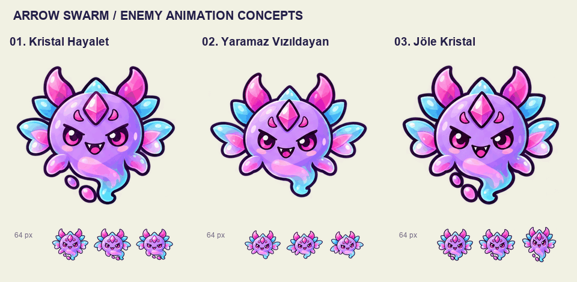

# Enemy animasyon örnekleri

GameScene'deki mor, pembe kristalli ve turkuaz yüzgeçli karakter referans alınarak üç animasyon önizlemesi hazırlandı.

[Oynatılabilir galeri](index.html) · [Üçünü yan yana izle](enemy-animation-comparison.gif)

1. **Kristal Hayalet:** daha sakin süzülme, göz kırpma ve kuyruk hareketi. [GIF](01-kristal-hayalet.gif)
2. **Yaramaz Vızıldayan:** belirgin yüzgeç çırpışı ve enerjik salınım. [GIF](02-yaramaz-vizildayan.gif)
3. **Jöle Kristal:** ezilip uzayan gövde ve esnek kuyruk. [GIF](03-jole-kristal.gif)

Galeride büyük görünüm ve 64 px örnekler, duraklatma, normal/yavaş oynatma ve krem/koyu zemin kontrolleri bulunur. GIF'ler krem zeminli önizlemelerdir; kaynak PNG kareleri gerçek şeffaflık içerir.

Bu çalışma örnek tasarım ve animasyon önizlemesidir. Unity sahneleri, enemy prefabı ve oyun kodları değiştirilmedi.

## Üretim notları

- Çizim aracı: yerleşik **image_gen**. Üç ayrı referanslı üretim kullanıldı.
- Referans: `Assets/_Project/Art/_FarzetkiArts/ArrowSwarm_Artx (3).png`.
- [Tam prompt seti](prompts.json) · [Üretim dosyaları](generation.json).
- Her seçenek 16 çizilmiş animasyon karesi içerir. Tek resmin hareket ettirilmesi yerine göz, yüzgeç, kuyruk ve gövde pozları değişir.
- Kaynak görseller korunur. `decode_atlases.py` gerçek karakter sınırlarını okur; `encode_previews.py` bu kareleri GIF olarak oynatılabilir biçime getirir.
- [Kare sınırları](frame-rects.json) · [Önizleme doğrulaması](preview-verification.json).
