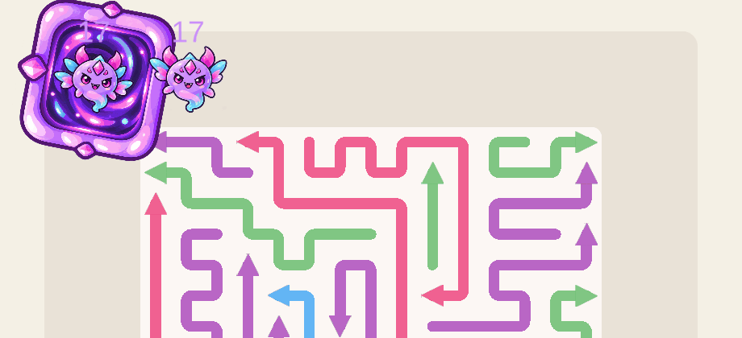

# GameScene enemy animasyonu

Onaylanan ikinci örnek, **Yaramaz Vızıldayan**, mevcut enemy prefabına eklendi. Bu sürüm, yüzgeçler ile gövde/kuyruk hareketini birlikte içeren mevcut animasyonu kullanır.

## Gerçek oyun kaydı

[Tam oyun kaydı](gameplay.gif) · [Tam boyut ekran görüntüsü](gameplay.png) · [Donmuş görünüm](frozen-gameplay.png)

Kayıt gerçek GameScene 101'den, normal oyun hızıyla alındı. GIF, ekran görüntülerinin ölçülen süresiyle oynatılır; görüntü alma sıklığı oyunun render hızını temsil etmez.

## Kontroller

- On altı animasyon karesinin gerçek enemy üzerinde oynadığı doğrulandı.
- HP yazısı, collider, yön değiştirme ve mevcut yol hareketi korunuyor.
- Duraklatma ve donma animasyonu durdurur; devam edildiğinde sürer.
- Donmuşken hasar sonrası buz rengi korunur.
- Gerçek ok çarpışması, ölüm, aynı enemy'nin yeniden kullanılması ve bitişte can kaybı kontrol edildi.
- Oyuncu ilerlemesi, envanter, kayıtlar ve ayarlar korunur.

[Runtime test raporu](runtime-verification.txt) · [Defense genel testi](defense-verification.txt) · [Varlık kontrolü](asset-verification.txt) · [Prefab kontrolü](prefab-verification.txt) · [Kayıt kontrolü](capture-verification.json) · [Mevcut dosyaların kontrolü](isolation-verification.txt)
