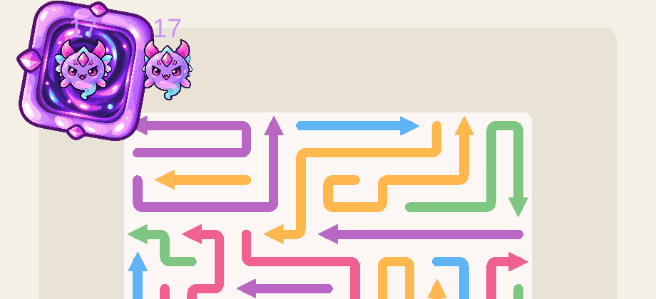

# Sadece kanat çırpan enemy

Gövde, yüz, boynuzlar ve kuyruk tek bir sabit sprite olarak kalır. Yalnızca iki ayrı kanat bağlantı noktasından çırpar. Mevcut yolda ilerleme ve hasar tepkisi korunur.

[Tam oyun kaydı](gameplay.gif) · [Ekran görüntüsü](gameplay.png) · [Donmuş görünüm](frozen-gameplay.png)

## MCP doğrulaması

Gerçek GameScene 101'de 146 kontrol geçti; son konsolda hata yok.

- 32 kare boyunca gövdenin sprite'ı, yerel konumu, dönüşü ve ölçeği sabit kaldı.
- Her iki kanatta 31 ayrı poz gözlendi; klip yalnızca WingLeft ve WingRight dönüş/ölçeklerini değiştirir.
- Donma ve duraklatma iki kanadı da durdurur; devam edilince kaldıkları yerden sürer.
- Gövde ve kanatlar donma, hasar ve yeniden kullanımda birlikte doğru rengi alır.
- Gerçek ok çarpışması, can yazısı, ölüm, aynı enemy'nin havuzdan yeniden kullanılması ve bitişte can kaybı geçti.
- Oyuncu verileri/ayarları geri yüklendi; 266 korunan dosya özeti ve önceden değiştirilmiş 10 dosyanın ilk içerikleri doğrulandı.

Kayıt normal oyun hızında alındı. GIF, 5,277 saniyelik ölçülen kaydı formatın 10 ms hassasiyetine yuvarlayarak oynatır. Görüntü alma sıklığı oyunun render hızını temsil etmez.

[Runtime raporu](runtime-verification.txt) · [Varlık kontrolü](asset-verification.txt) · [Prefab kontrolü](prefab-verification.txt) · [Kayıt kontrolü](capture-verification.json) · [Mevcut dosyaların kontrolü](isolation-verification.txt)

[Görsel kaynağı, kullanılan araç ve tam üretim prompt'u](../../Docs/ENEMY_WINGS_ONLY.md)
