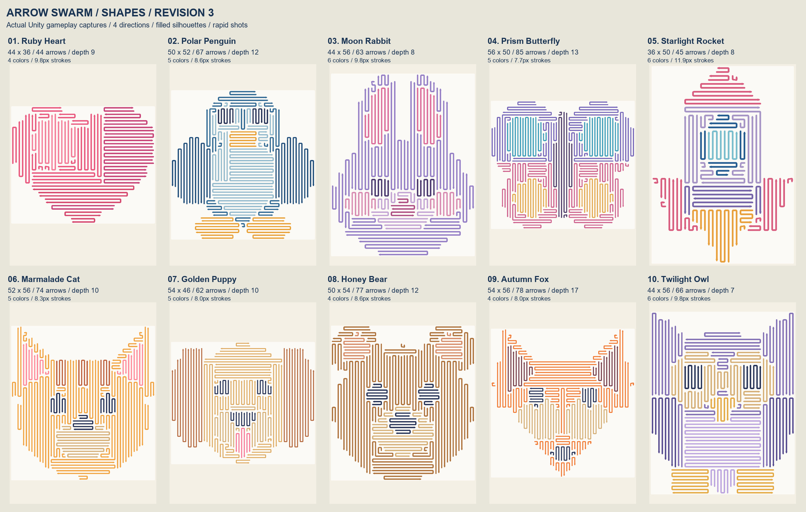
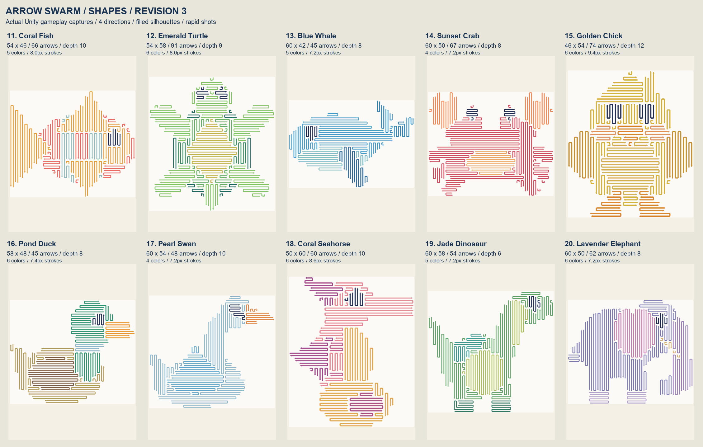
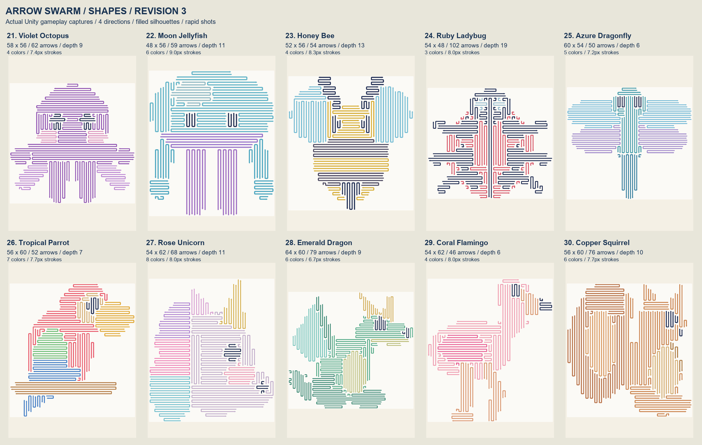
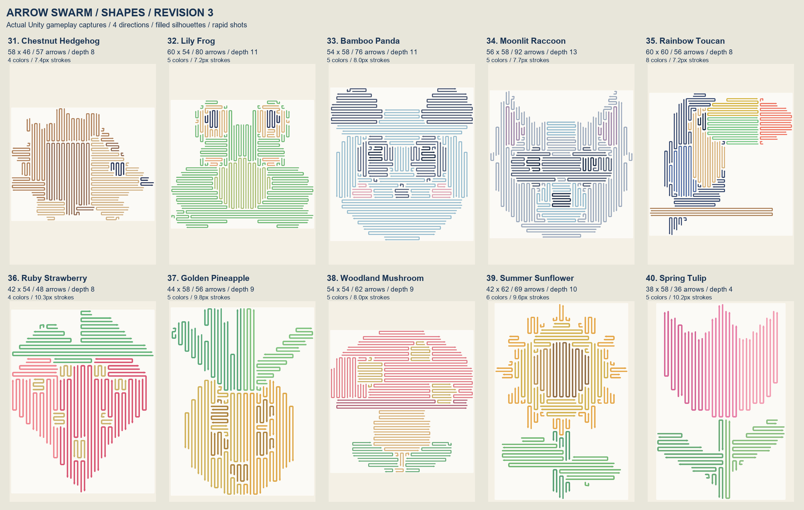
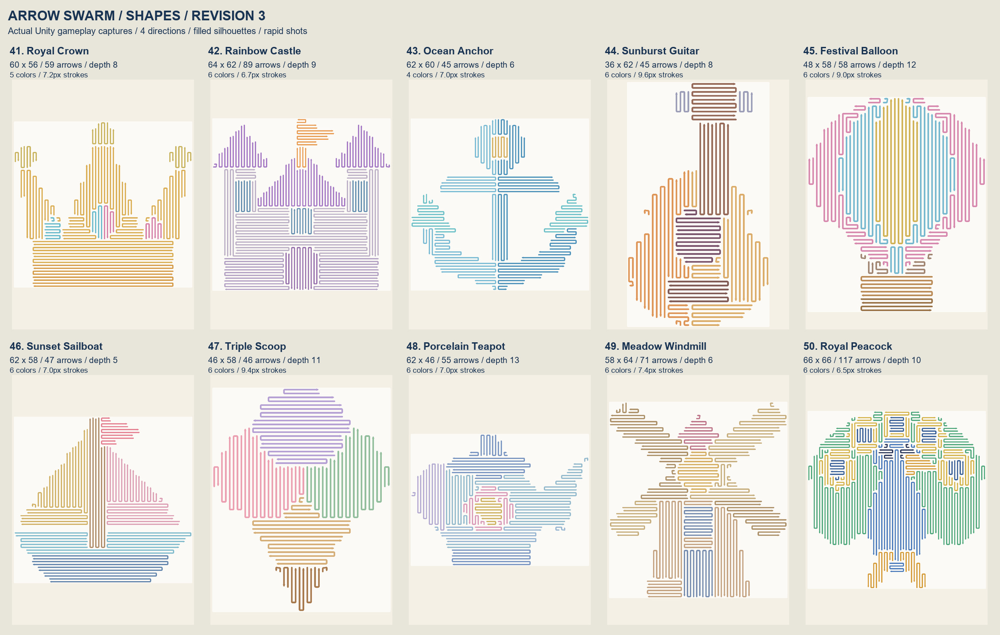
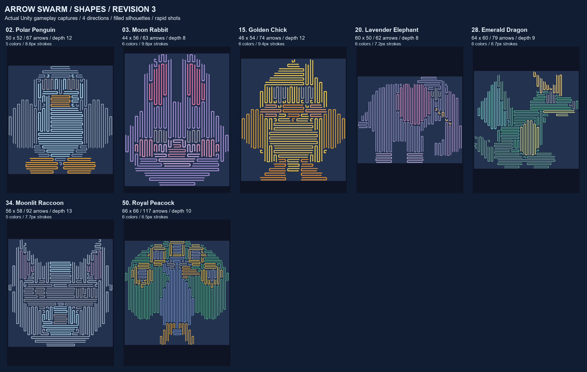

# Shapes Revision3 Overview

50 gerçek Unity sahnesi · 41 farklı grid ölçüsü · 36–117 ok · ortalama 63.7 ok.

[Bölüm bölüm tam boyut galeri](index.html) · [50 bölüm oynanış testi](Playthroughs/runtime-verification.txt) · [Ölçümler](Playthroughs/level-metrics.csv)

## Bölüm 1–10

## Bölüm 11–20

## Bölüm 21–30

## Bölüm 31–40

## Bölüm 41–50

## Koyu tema

Tüm bölümler 4 yönde, tam silüet kapsamıyla ve eşzamanlı atışlarla test edildi. Görseller mockup değil, gerçek oyun sahnesinden alındı.
