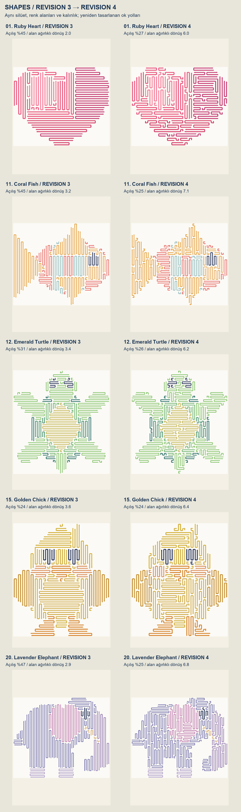
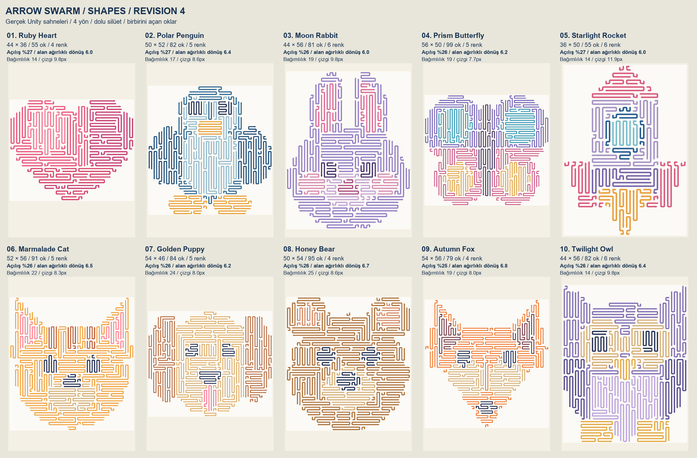
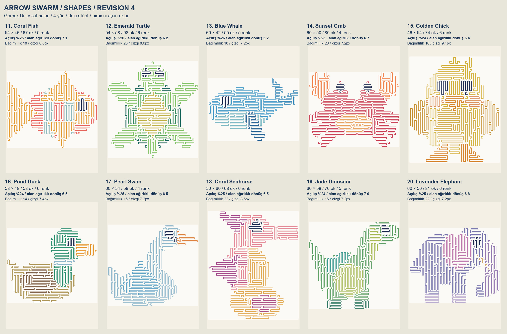
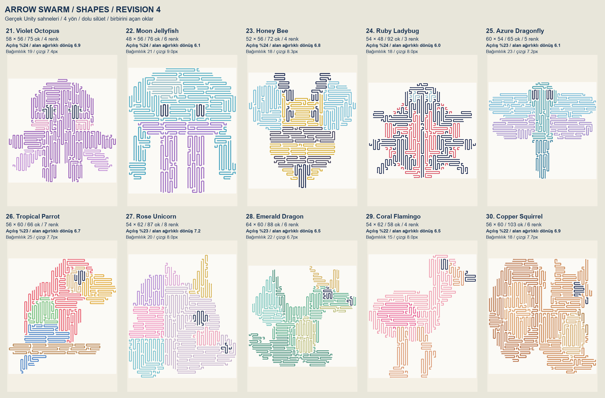
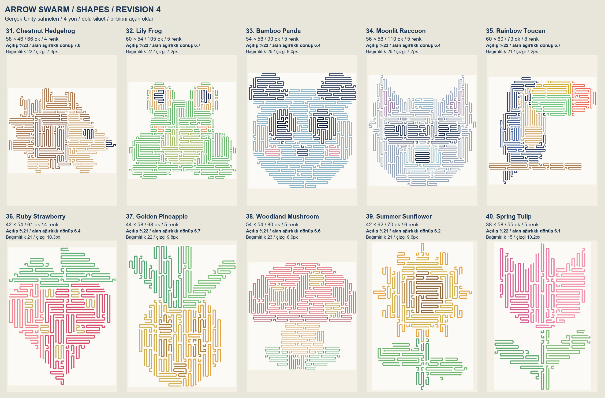
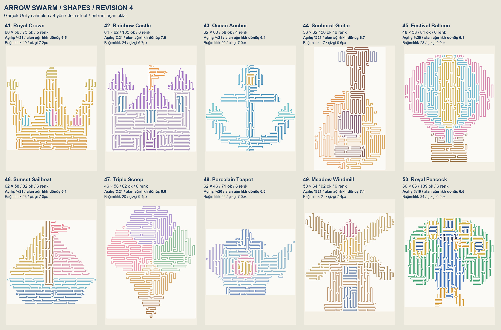
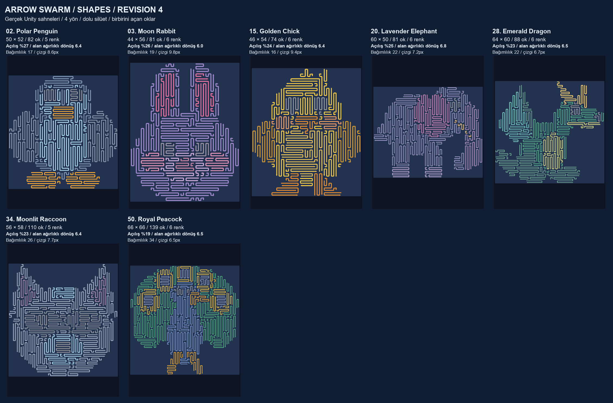

# Shapes Revision4 Overview

50 gerçek Unity sahnesi · 41 farklı grid ölçüsü · 55–139 ok · ortalama 78.1 ok.

[Tam boyut galeri](index.html) · [R3 / R4 karşılaştırma](Overview/shapes-before-after.jpg)

Açılışta seçilebilen okların ortalaması %41.5 → %23.4; çözümün orta kısmındaki serbest seçenek oranı %42.3 → %19.6. Daha fazla ok, önce başka okların çıkarılmasını gerektiriyor; tüm bölümler çözülebilir kalıyor.

Alan ağırlıklı dönüş sayısı 3.17 → 6.51. Bu ölçüm uzun yolları daha fazla ağırlıklandırır; küçük kıvrımlı oklar sonucu şişirmez. R2’nin çok sık kıvrımları ile R3’ün uzun paralel şeritleri arasında daha okunaklı yollar hedeflendi.

İlk 10 bölümde açılış seçenekleri ortalama %26.3; son 10 bölümde %20.6. Daha az serbest seçenek bırakan kademeli bir ilerleme hedeflendi.

R3 silüeti, hücre renkleri, boyutları ve ok kalınlığı korunur. Açılış yüzdesi ilk hamlede çıkabilen okların oranıdır. Bu oranlar yapısal ölçümlerdir; hissedilen zorluk oyuncunun çözüm sırasına göre değişir.

## R3 → R4 karşılaştırması

1, 11, 12, 15 ve 20. bölümlerin aynı şekilde kırpılmış gerçek Unity görüntüleri.

## Bölüm 1–10

## Bölüm 11–20

## Bölüm 21–30

## Bölüm 31–40

## Bölüm 41–50

## Koyu tema

## Doğrulama raporları

- [Denge doğrulaması](balance-comparison.txt)
- [Yeni denge ölçümleri](balance-candidates.csv)
- [R3 başlangıç ölçümleri](balance-baseline.csv)
- [R2 karşılaştırması](balance-legacy-summary.json)
- [12 farklı çözüm sırası](policy-comparison.txt)
- [50 bölüm oynanış testi](Playthroughs/runtime-verification.txt)
- [Sahne ölçümleri](Playthroughs/level-metrics.csv)
- [Hızlı atış ve etkileşim testleri](interaction-verification.txt)
- [HUD ve yerelleştirme testleri](ui-verification.txt)

Görseller mockup değil, gerçek oyun sahnesinden alınmıştır. 50 bölüm tam silüet kapsamı, çözülebilirlik ve hızlı çoklu atışlarla doğrulanır.
