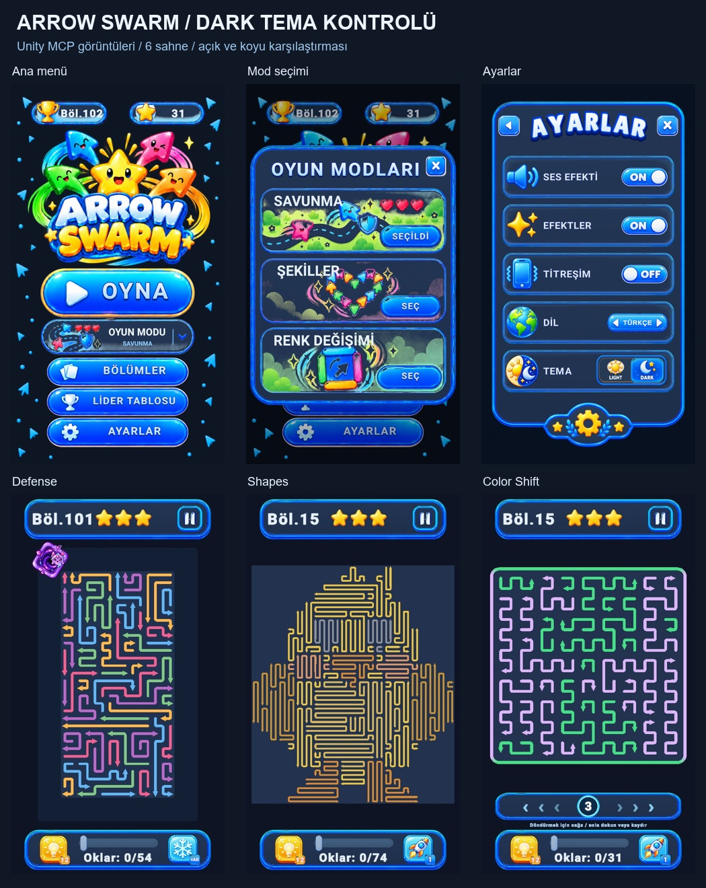

# Dark tema kontrolü — 23 Ekim 2026

Ana menü ve mod seçiminin zeminleri, kartları, yazıları ve kapatma düğmesi koyu temaya bağlandı. Logo ve karakter parlamaları temiz bir şeffaf Night görseliyle korundu; açık tema kendi özgün görselini kullanmaya devam ediyor. Harita önizlemesindeki açık kalan sekiz panel/iz bileşeni Defense paletine uyarlandı. Sahne geçişleri kayıtlı temayı izliyor ve animasyon sırasında tema değişirse ilerleme/merkez/giriş engeli korunuyor.

Tablet kontrolünde ortaya çıkan eski menü taşmaları da giderildi: üç uzun pencere, animasyonlarının kendi ölçeğine dokunmadan ayrı bir yerleşim katmanında ekrana sığıyor. Normal telefon görünümünde ölçekleri 1 kalıyor. Uzun yerelleştirilmiş bölüm aralıkları tek satıra sığıyor; eksik font karakteri kullanan kapatma etiketi düzeltildi.

## Kontroller

| Alan | Sonuç |
|---|---|
| 6 build sahnesi, 30 ekran durumu | 60 gerçek Unity görüntüsü; Light→Dark→Light materyal/görsel/renk dönüşü başarılı |
| Normal telefon, uzun telefon, tablet menüleri | 1080×1920, 1080×2400, 1536×2048; ayrıca 470×836 temel karşılaştırması |
| Koyu görsel shader kontrolleri | 47 GPU kontrolü başarılı; logo parlamaları, alpha ve basılı köşeler korunuyor |
| Önceki buton/geçiş shader testleri | 111 kontrol başarılı |
| Gerçek işaretçi girişleri | İki temada beş butonun basılı tutma, dışarı çıkma, dışarıda bırakma ve devre dışı davranışı başarılı |
| Canlı UI ve geçiş kontrolleri | 65 kontrol başarılı; seçildi etiketleri, üç modda tekrar kullanılan bölüm butonları, leaderboard yenileme ve geçişin iki yarısında tema değişimi |
| Gerçek sahne rotaları | İki temada üç moda gidiş/dönüş, tam kapalı yükleme ve giriş engelinin bırakılması başarılı |

## Görseller ve kanıtlar

- [Tüm koyu menüler](../Captures/DarkThemeRevision/FinalOverview/menus-dark.jpg) · [Açık menüler](../Captures/DarkThemeRevision/FinalOverview/menus-light.jpg)
- [Koyu oyun ekranları](../Captures/DarkThemeRevision/FinalOverview/gameplay-dark.jpg) · [Açık oyun ekranları](../Captures/DarkThemeRevision/FinalOverview/gameplay-light.jpg)
- [Koyu geçiş kareleri](../Captures/DarkThemeRevision/Transitions/wipe-dark.jpg) · [Açık geçiş kareleri](../Captures/DarkThemeRevision/Transitions/wipe-light.jpg)
- [Canlı UI test kaydı](../Captures/DarkThemeRevision/Live/live-theme.txt)
- [Native görüntü isimleri ve SHA-256 manifesti](../Captures/DarkThemeRevision/FinalOverview/screens.json)
- [Night görseli](../Assets/_Project/Art/Sprites/ModeMenu/MainMenuNightCutout.png) · [ImageGen yöntemi ve kullanılan tam prompt](DARK_THEME_ART.md)
- [Aşamalar ve devam kaydı](DARK_THEME_COMPLETENESS.md)

## Koruma ve ortam notu

Oynanış kuralları, kampanya verileri, enemy/arrow animasyonları ve mevcut yetenekler değiştirilmedi. Önceden değiştirilmiş altı çözüm/font dosyası özel bir kopyayla korundu; testler oyuncu ilerlemesini, yıldızları, envanteri ve beş veri tercihini geri yüklüyor.

Asıl Unity editöründeki harici dosya yenileme penceresi masaüstü kontrolünden erişilemediği için son MCP testleri aynı kaynak dosyalarını kullanan ayrı bir doğrulama projesinde yapıldı. Düzenlenen kaynak/sahne/materyal/görsel dosyaları byte karşılaştırmasıyla doğrulandı. Asıl editördeki yenileme penceresinin kullanıcı tarafından kapatılması gerekebilir; kaynak değişiklikleri ve commitler ana projededir.

Son durum: Native console **0 hata / 0 uyarı**; altı sahnede **0 eksik script**. Beş özgün veri tercihi ve önceden değiştirilmiş altı dosya birebir geri yüklendi. Standart telefonda üç pencerenin yerleşim ölçeği **1.0** olarak doğrulandı.
